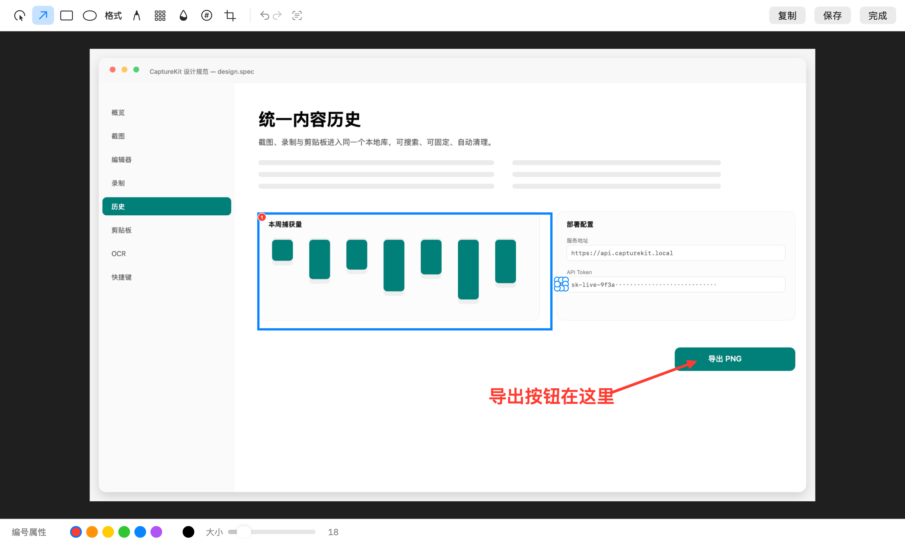
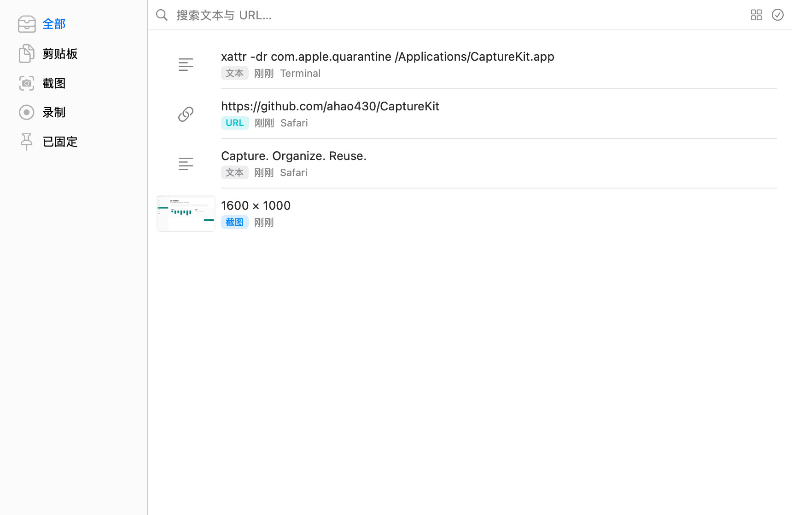
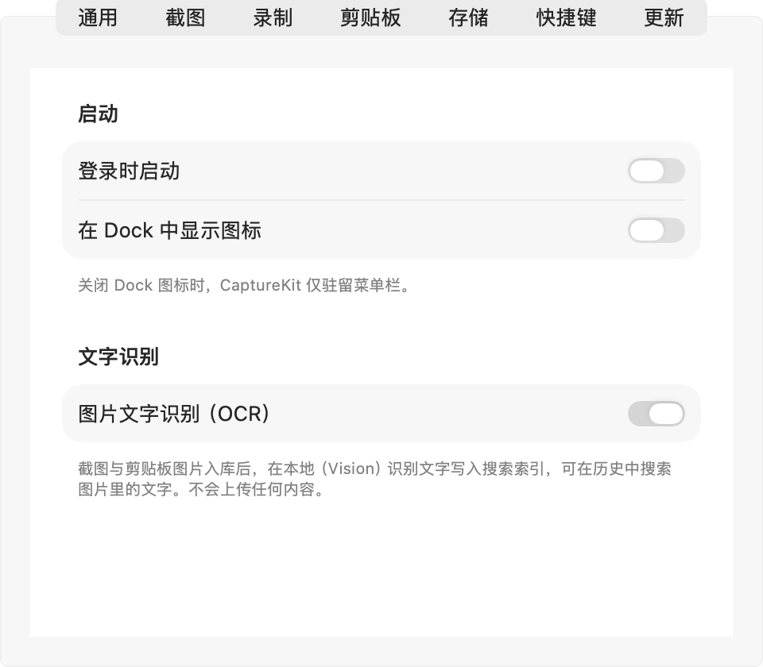

# CaptureKit

> macOS 内容捕获与复用工具 — Capture. Organize. Reuse.

**在线主页（下载 / 功能介绍 / 安装教程）：<https://ahao430.github.io/CaptureKit/>**

轻量、原生、注重效率的菜单栏应用：截图、录屏（后续）、剪贴板历史（后续）、统一内容管理（后续）。双语主页，默认中文。

## 下载安装

1. 从 [在线主页](https://ahao430.github.io/CaptureKit/) 或 [GitHub Releases](https://github.com/ahao430/CaptureKit/releases) 下载最新 `CaptureKit.dmg`（两处的下载按钮始终指向最新版）。
2. 打开 DMG，把 CaptureKit 拖入 Applications。
3. CaptureKit 暂未做 Apple 公证，首次打开可能被 Gatekeeper 拦截。拖入 Applications 后在终端执行：

   ```bash
   xattr -dr com.apple.quarantine /Applications/CaptureKit.app
   ```

   该命令只移除下载隔离属性，不是安全验证——请只对信任来源使用。若安装在其它位置，替换路径。
4. 启动；首次截图会请求「屏幕录制」权限，允许后重新触发即可。

应用内置 Sparkle 自动更新（每 24 小时经 GitHub Releases 检查一次，EdDSA 验签，安装前需确认；也可菜单右键「检查更新…」）。更新后若再次被拦截，重跑上面同一条 `xattr` 命令。

**屏幕录制授权须知**：
- 必须把应用放入「应用程序」文件夹后从那里启动。直接从 DMG 打开时，macOS 会把应用迁移到随机临时路径（App Translocation），导致**每次启动都要求重新授权**。
- 右键「打开」只跳过首次拦截，不会移除隔离属性；请用上面的 `xattr` 命令。
- v0.1.4 起安装包改用**固定的自签名证书**签名（此前为 ad-hoc，每次构建指纹都不同，macOS 难以为它保留屏幕录制授权，表现为「授权后仍反复弹窗」）。这是针对该问题的修复，效果以实际使用为准；如更新后仍被要求重新授权，请提 issue 反馈。
- 从 v0.1.2 及更早版本升级：需要重新授权一次。建议先在终端执行 `tccutil reset ScreenCapture com.wanghao.capturekit` 清掉旧条目，再安装 v0.1.4 并授权。

## 界面一览

**标注编辑器**（8 种标注 + 马赛克/模糊 + 非破坏性裁剪）：



**统一历史**（截图/录制/剪贴板一站式检索）与**设置**（隐私优先 + 自动更新）：





## 当前状态

**Phase 0–5 全部完成**（截图全链路、录制含预览编辑器、统一历史 + 剪贴板两批次，见 `docs/development-progress.md`）。

已实现：

- 菜单栏：左键 Popover + 右键 NSMenu，无 Dock 图标（可切换）
- 截图：区域/全屏/窗口、**悬停十字参考线**、放大镜（坐标 + HEX 取色，`C` 复制颜色）、窗口吸附、延时截图、**滚动长图**（自动滚动需辅助功能权限，可手动降级）
- **一体化选区工具栏**（钉钉式，选中即用、无模式切换）：
  上行 = 选择 + 矩形/椭圆/箭头/画笔/马赛克/文字/编号 + 8 色 + 线宽三档 + 撤销；
  下行 = 贴图 / OCR / 长截图 / 录制 / 保存 / 复制 / 取消
- **选区内直接标注 + 可编辑**：绘制工具即点即画；「选择」工具下点选已画标注拖动移动，⌫/右键删除，改色改线宽实时生效；⌘Z 撤销；Enter 复制含标注截图
- **贴图**：截图钉在屏幕原位置顶显示，拖动移动、滚轮缩放、⌥滚轮调透明度、双击还原、悬停关闭
- 编辑器（V/A/R/O/T/P/M/B/N + 裁剪 C）：8 种标注 + 马赛克/模糊/编号 + 非破坏性裁剪 + Undo/Redo
- 录制（⇧⌘R）：区域/全屏/**窗口**，mp4（H.264 流式）与 GIF（ImageIO 流式），HUD 不入镜，暂停段时间轴自动移除，
  可选**系统音频**（AAC）、**麦克风**（macOS 15+，TCC 授权）与**鼠标点击高亮**（默认关）
- **录制预览编辑器**：AVPlayer 播放、双把手时间轴裁剪（预览循环）、**速度调节（0.5×–2×）**、
  导出 mp4（passthrough/720p/1080p/480p）或 GIF（10/15/20 FPS + 宽度上限），录制完成自动打开（可关）
- **录制预览编辑器**：AVPlayer 播放、双把手时间轴裁剪（预览循环）、速度调节（0.5×–2×）、
  **GIF 删帧**（胶片条点选排除片段）、导出 mp4（passthrough/720p/1080p/480p）或 GIF（10/15/20 FPS + 宽度上限），录制完成自动打开（可关）
- **统一历史**（⌘⇧H）：截图/录制/剪贴板统一入库（SQLite + 文件存储），列表/网格切换、分类、搜索、
  缩略图、复制恢复、Pin、Finder 定位、删除（关联文件同步清理）、自动清理（Pin 豁免）
- **快速剪贴板**（⌘⇧V）：搜索 + 键盘导航 + Enter 复制自动关闭 + 失焦关闭
- **剪贴板管理**：多 representation 采集、类型分类、敏感内容过滤、哈希去重、应用排除、暂停监听——**默认关闭，设置中开启**
- **OCR 文字识别**（Vision 本地）：编辑器一键识别 + 复制；截图/图片入库后台写入搜索索引（可搜索图片内文字）
- 历史批量删除（选择模式 + 全选 + 确认）
- **自动更新**（Sparkle 2）：每日检查 + 手动检查，EdDSA 验签，安装需确认，关闭系统剖析上报（隐私）
- **项目图标**：gpt-image 生成（取景框 + 光圈主题，macOS squircle 规范），Dock/关于面板/AppIcon 套装
- 设置：通用（含 OCR）/ 截图 / 录制 / 剪贴板（隐私）/ 存储（占用与清空）/ 快捷键 / 更新

## 构建

依赖：Xcode 16+（macOS 14 SDK）、[xcodegen](https://github.com/yonaskolb/XcodeGen)。

```bash
xcodegen generate        # 由 project.yml 生成 CaptureKit.xcodeproj
open CaptureKit.xcodeproj
# Xcode 中 ⌘R 运行，⌘U 跑测试
```

命令行：

```bash
xcodebuild -project CaptureKit.xcodeproj -scheme CaptureKit -destination 'platform=macOS' build
xcodebuild -project CaptureKit.xcodeproj -scheme CaptureKit -destination 'platform=macOS' test
```

## 手动验证

1. 运行 app → 菜单栏出现取景框图标，Dock 无图标；左键弹出 Popover，右键弹出菜单（含「检查更新…」）。
2. 按 ⌘⇧A（或 Popover「截图」）→ 首次触发系统屏幕录制授权弹窗，允许后重新触发。
3. 拖拽选区（放大镜跟随）→ 松开出现控制点与工具栏 → Enter → 自动进入编辑器。
4. 编辑器：A/R/O/T/P 画标注；M 马赛克、B 模糊遮敏感信息；N 编号（自动递增）；C 裁剪（选比例 → 拖框 → Enter）。
5. V 选择 → 拖动/控制点调整/Delete 删除；双击文字重新编辑；Inspector 按对象类型显示属性。
6. ⌘Z 撤销、⌘⇧Z 重做（含裁剪）；⌘C 复制合成图、⌘S 保存 PNG（与画布显示一致）。
7. 录制：⇧⌘R 拖框回车 → HUD 计时 → 停止 → 预览编辑器：空格播放、拖双把手裁剪、导出 MP4/GIF；右键菜单可录 GIF/全屏/窗口。
8. 历史：⌘⇧H → 查看截图/录制条目（可切网格视图、进入选择模式批量删除）；⌘⇧V → 快速面板，Enter 复制选中；设置中开启剪贴板后复制内容自动入库（敏感密钥会被跳过）；截图含文字时可直接在历史搜索到（OCR）。
9. 长图：Popover「滚动截图（长图）」→ 选区 → 自动滚动（需辅助功能授权，可手动降级）→ 编辑器打开拼接长图。
10. GIF 删帧：录制编辑器选 GIF → 时间轴下方胶片条点按格子移除片段 → 导出。
11. 无选区时鼠标划过窗口 → 高亮；单击 → 选中整窗；双击 → 直接捕获该窗口。
12. 设置 → 快捷键录制新组合；延时截图倒计时可取消；设置 → 更新 → 「立即检查…」弹出 Sparkle 检查面板。
13. 外接显示器重复（重点：选区与捕获内容一致，无偏移）。

## 项目文档

| 文档 | 内容 |
| --- | --- |
| `PLAN.md` | 产品规划与分阶段开发计划 |
| `DESIGN.md` | 技术架构与模块设计（§22 Build & Release） |
| `UI_DESIGN.md` | UI / UX 设计规范 |
| `docs/index.html` | Homepage（GitHub Pages 发布） |
| `docs/phase-0-validation.md` | Phase 0 技术验证报告 |
| `docs/architecture-decisions.md` | 关键技术决策记录（ADR-001–029） |
| `docs/development-progress.md` | 开发进度跟踪 |
| `docs/releasing.md` | 发布运维手册（密钥/Secret/Pages/验收） |

## 最低系统要求

macOS 14.0（Sonoma）+ Apple Silicon。
